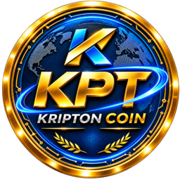

<p align="center"></p>

# KRIPTON (KPT)

Eigenständige Layer-1-Blockchain mit fester Menge von **10.000.000 KPT**.
Website: **https://kripton.live**

Dieses Repository enthält **nur Chain-Daten** (Genesis und Registry-Dateien), keinen Quellcode.

| | |
|---|---|
| Chain-ID | `kripton-1` |
| Coin | KPT, kleinste Einheit `ukpt` (1 KPT = 100.000.000 ukpt, 8 Nachkommastellen) |
| Adressen | `kripton1…` |
| Genesis sha256 | `1e68db6ed52754fc84c7f793dbf5c64fcd70036420334a2f2d61b5722aa5c2e5` |
| RPC | https://rpc.kripton.live |
| REST | https://api.kripton.live |
| Block-Explorer | https://kripton.live/explorer/ |
| Peer | `13d588d179741b6e165d4844ff2e691c281c0a7b@kripton.live:26656` |
| IBC zu Osmosis | KRIPTON `channel-0` ↔ Osmosis `channel-111106` (seit 13.11.2026) |
| KPT auf Osmosis | `ibc/B2F710776B6275553AC5C26DF5730D0ABB9ADA55CF3461646BBBF09BC28CFE39` |
| Pool | Osmosis KPT/USDC-Pool [#3699](https://app.osmosis.zone/pool/3699), tauschen über https://kripton.live/handel/ |

## Menge selbst prüfen

```bash
# Gesamtmenge in ukpt: muss 1000000000000000 sein (= 10.000.000 KPT)
curl -s "https://api.kripton.live/cosmos/bank/v1beta1/supply/by_denom?denom=ukpt" | jq -r .amount.amount

# Genesis-Datei gegen die veröffentlichte Prüfsumme prüfen
sha256sum -c genesis.sha256
```

## Inhalt

| Datei | Zweck |
|---|---|
| `genesis.json`, `genesis.sha256` | Genesis-Datei von `kripton-1` und ihre Prüfsumme |
| `registry/kripton/chain.json` | Chain-Beschreibung für die Cosmos Chain Registry |
| `registry/kripton/assetlist.json` | Coin-Beschreibung (KPT) für die Registry |
| `registry/kripton/versions.json` | Software-Versionen und Upgrades |
| `registry/kripton/images/kpt.png` | Logo |
| `registry/_IBC/kripton-osmosis.json` | IBC-Kanal zu Osmosis |

## Hinweis

Keine Anlageberatung und kein Angebot zum Kauf. Der einzige Marktplatz für KPT ist ein sehr kleiner Pool auf Osmosis (#3699); sein Preis kann stark schwanken. Kryptowerte sind riskant, ein Totalverlust ist möglich.
